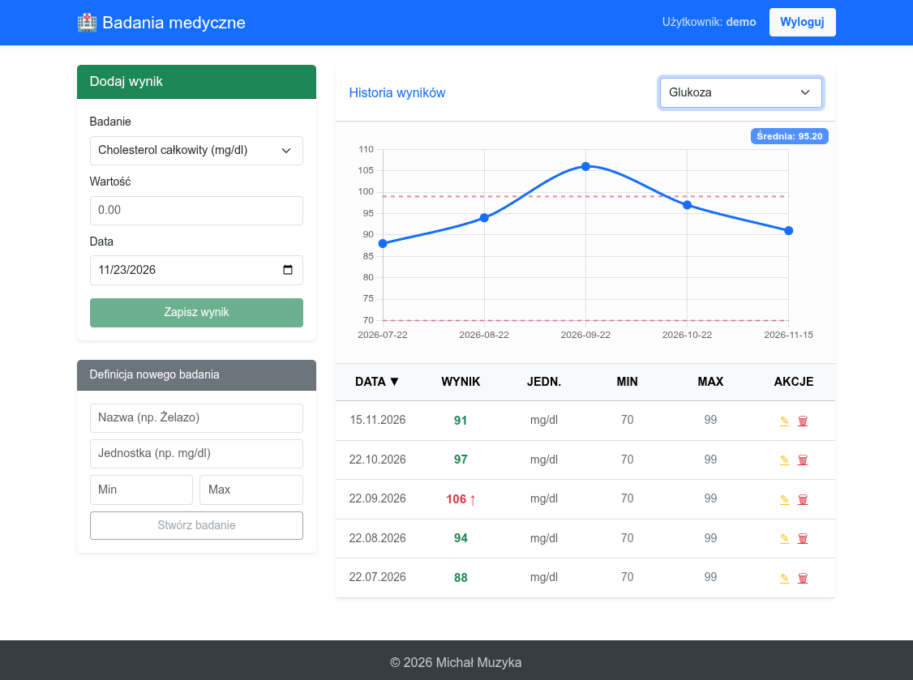

# Health Data Tracker Java

A web application for tracking, analyzing, and visualizing personal health and medical laboratory test results over time.

The project allows users to log and monitor health metrics (such as blood glucose, complete blood count / hemoglobin, lipid profiles, blood pressure, and vitamins) with automatic reference norm evaluations, trend charts, and customizable private health parameters.

---

## Screenshots



---

## Features

- **Interactive Health Metric Charting:** Historical timeline charts powered by Chart.js and ng2-charts with visual dashed lines displaying minimum and maximum reference norms.
- **Reference Norms & Health Indicators:** Instant visual feedback on every test entry—values within range are highlighted in green, while values exceeding or falling below reference limits are flagged with red directional arrows (↑ / ↓).
- **Metric Aggregation & Sorting:** Real-time computation of average metric values for selected tests, paired with multi-column sorting by date and measurement value.
- **Custom Parameter Management:** Support for global system parameters alongside private, user-defined laboratory tests with customized measurement units and reference thresholds.
- **Full CRUD for Health Records:** Easy creation, update, and deletion of test results and personal parameters with modal dialog confirmations.
- **Secure Authentication:** Stateless JWT (JSON Web Token) authentication with BCrypt password encryption and protected API endpoints.
- **Automatic Database Seeding:** The backend automatically registers default system medical parameters, creates a demo user account, and populates sample historical test results on startup.

---

## Tech Stack

- **Backend:** Java 25, Spring Boot 4 (Spring Data JPA, Spring Security, Spring Web MVC), PostgreSQL Driver, JJWT, Lombok, Springdoc OpenAPI 3.0 (Swagger UI)
- **Frontend:** Angular 21, TypeScript, Reactive Forms, Bootstrap 5, Chart.js, ng2-charts, RxJS
- **Database:** PostgreSQL 16
- **Testing:** JUnit 5, Mockito, H2 Database (Backend), Vitest, Angular Testbed (Frontend)
- **Deployment:** Docker, Docker Compose, Nginx

---

## API Documentation (Swagger UI)

The backend provides interactive API documentation powered by **Swagger UI (OpenAPI 3.0)** with full JWT Bearer authorization support.

When running the application (via Docker or locally), the Swagger UI is available at:
👉 **[http://localhost:8080/swagger](http://localhost:8080/swagger)** *(navigating to `http://localhost:8080/swagger` automatically redirects to Swagger UI)*

An offline OpenAPI 3.0 specification file is also available in the repository at [`docs/swagger.json`](docs/swagger.json).

### Available Endpoints

| Method | Endpoint | Access | Description |
|---|---|---|---|
| `POST` | `/auth/register` | Public | Register a new user account |
| `POST` | `/auth/authenticate` | Public | Authenticate user credentials and receive a JWT Bearer token |
| `GET` | `/api/parameters` | Bearer Token | Retrieve all accessible test parameters (system norms & user-defined) |
| `POST` | `/api/parameters` | Bearer Token | Define a new custom test parameter with unit and reference ranges |
| `PUT` | `/api/parameters/{id}` | Bearer Token | Update an existing custom test parameter |
| `DELETE` | `/api/parameters/{id}` | Bearer Token | Delete a custom test parameter and its associated results |
| `GET` | `/api/results` | Bearer Token | Retrieve all historical test results for the authenticated user |
| `POST` | `/api/results` | Bearer Token | Record a new medical test result with date, value, and parameter |
| `PUT` | `/api/results/{id}` | Bearer Token | Update an existing test result value or date |
| `DELETE` | `/api/results/{id}` | Bearer Token | Remove a specific test result record |

### How to Test Endpoints in Swagger UI

1. Open **[http://localhost:8080/swagger](http://localhost:8080/swagger)** in your browser.
2. Under the **Authentication** section, expand `POST /auth/authenticate`, click **Try it out**, and submit the demo credentials:
   ```json
   {
     "username": "demo",
     "password": "demo123"
   }
   ```
3. Copy the `token` string from the JSON response body.
4. Click the green **Authorize** button (🔓) located at the top-right of Swagger UI.
5. In the input field, paste the copied token (Swagger UI automatically adds the `Bearer ` prefix):
   ```text
   <your_copied_token>
   ```
6. Click **Authorize**, then **Close**.
7. You can now execute requests against protected endpoints under **Test Parameters** (`/api/parameters`) and **Test Results** (`/api/results`) directly from your browser.

---

## Quick Start (Docker)

### Requirements
- [Docker Engine & Docker Compose](https://docs.docker.com/get-docker/)

### 1. Clone the repository
```bash
git clone https://github.com/musmike/health-data-tracker-java.git
cd health-data-tracker-java
```

### 2. Build and start the demo stack
Run the complete multi-container stack (database, backend, and frontend) using the demo compose configuration:
```bash
docker compose -f docker-compose.demo.yml up -d --build
```

### 3. Open in browser
- **Frontend App:** [http://localhost:4200](http://localhost:4200)
- **Swagger UI:** [http://localhost:8080/swagger](http://localhost:8080/swagger)

### Demo Credentials
The database is automatically seeded on startup with standard medical parameters and sample results. You can sign in using the default demo credentials:
- **Username:** `demo`
- **Password:** `demo123`

---

## Running Tests

### Backend Tests (Java / JUnit 5 & Mockito)
Run unit and integration tests using Maven:
```bash
cd backend
mvn test
```

### Frontend Tests (Angular / Vitest)
Run the Angular test suite:
```bash
cd frontend
npm install
npm test -- --watch=false
```

---

## Architecture & Ports

| Service | Technology | Port (Host) | Description |
|---|---|---|---|
| Frontend (`frontend`) | Angular 21 + Nginx | `http://localhost:4200` | Web application user interface |
| Backend & Swagger (`backend`) | Spring Boot 4 Web MVC | `http://localhost:8080` | REST API (`/swagger` for documentation) |
| Database (`db`) | PostgreSQL 16 | `localhost:5432` | Relational database instance |
